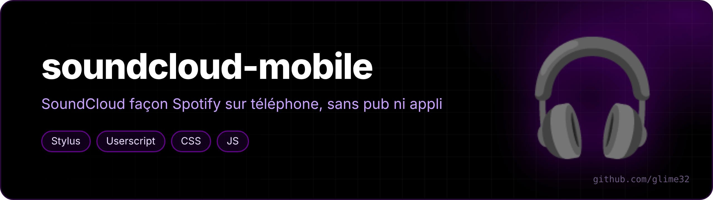

  

<a href="README.md">🇬🇧 English version</a>

Une interface tactile façon Spotify / YouTube Music pour SoundCloud sur téléphone, en restant sur la **version ordinateur** du site.

J'écoute SoundCloud sur mon téléphone (Galaxy A54, navigateur Titanium) en mode « site pour ordinateur » : pas de pub, pas de message pour installer l'appli. Sauf que cette version est inutilisable au doigt (tout est minuscule). Ce style + ce script la transforment en vraie appli mobile, en noir OLED avec du violet `#610089`.

## Ce que ça change

**Le style (`soundcloud-mobile.user.css`, Stylus)**

- page agrandie automatiquement à la largeur de l'écran (en portrait seulement, rien ne change sur PC) ;
- barre de navigation en bas : Accueil / Fil / Bibliothèque ;
- lecteur en carte au-dessus de la barre : pochette, titre, cœur, file d'attente, grosse barre de progression, puis aléatoire · précédent · lecture · suivant · répéter ;
- Likes en grille de 3 colonnes, pochettes carrées, bouton lecture au milieu ;
- « Next up » en panneau au-dessus du lecteur, menus « … » en panneau en bas ;
- pubs Go+/Pro, bannières et footer cachés.

**Le script (`soundcloud-mobile.user.js`, Tampermonkey / Violentmonkey)**

- **aléatoire activé tout seul** quand tu lances un son ;
- **bouton « Aléatoire » rouge** sur les Likes et playlists : il charge *tous* les titres puis en lance un au hasard (SoundCloud ne mélange normalement que ce qui est déjà chargé) ;
- **écran qui reste allumé** pendant la lecture (Wake Lock) ;
- **passage au son suivant** si SoundCloud reste bloqué à la fin d'un titre ;
- **bulle avec le temps exact** quand tu fais glisser la barre de progression ;
- remet à la bonne taille le panneau de paroles de l'extension CloudLyrics (sinon il est agrandi avec le reste de la page).

## Installation

1. Installer [Stylus](https://github.com/openstyles/stylus) et [Tampermonkey](https://www.tampermonkey.net/) (ou Violentmonkey).
2. Cliquer sur [le style](https://raw.githubusercontent.com/glime32/soundcloud-mobile/main/soundcloud-mobile.user.css) puis sur [le script](https://raw.githubusercontent.com/glime32/soundcloud-mobile/main/soundcloud-mobile.user.js), et confirmer l'installation.
3. Ouvrir soundcloud.com en mode « site pour ordinateur ».

Les deux se mettent à jour tout seuls depuis ce dépôt.

Sur Android avec un navigateur Chromium, il faut activer « Autoriser les scripts utilisateur » (et parfois le mode développeur) dans les détails de Tampermonkey. Pour que la musique continue écran éteint, désactiver l'optimisation de batterie du navigateur.

## Réglages

- taille de la page : ligne `zoom: calc(100vw / 480px)` en haut du style (480 = plus petit, 420 = plus gros). Si tu la changes, change aussi le `480px` de `.playbackTimeline__progressWrapper`, qui sert à corriger le calcul de la barre de progression ;
- couleurs : variables `--v` (violet) et `--rouge` dans `:root`.

## Note

Le sélecteur `:is(html,#_)` qui revient partout sert juste à donner plus de priorité aux règles, pour passer devant les styles de SoundCloud et d'autres extensions de thème (comme DarkCloud).
