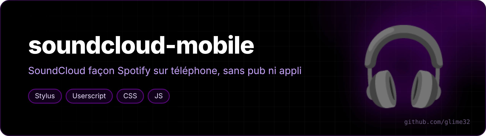

  

<a href="README.fr.md">🇫🇷 Version française</a>

**A Spotify / YouTube Music–style touch interface for SoundCloud on your phone — while staying on the desktop site** (no ads, no "get the app" prompts).

The desktop site is unusable with a finger (everything is tiny). This style + userscript turn it into a real mobile app, in OLED black with purple `#610089`.

## The style (`soundcloud-mobile.user.css`, Stylus)

- page automatically scaled to the screen width (portrait only — nothing changes on a PC);
- bottom navigation bar: Home / Feed / Library;
- card player above it: artwork, title, like, queue, big progress bar, then shuffle · previous · play · next · repeat;
- Likes as a 3-column grid with square artwork and a centered play button;
- "Next up" as a panel above the player, "…" menus as bottom sheets;
- Go+/Pro upsells, banners and footer hidden.

## The userscript (`soundcloud-mobile.user.js`)

- **shuffle turned on automatically** when you start a track;
- **red "Shuffle" button** on Likes and playlists that loads *all* tracks then plays a random one (SoundCloud normally only shuffles what's already loaded);
- **screen stays on** while playing (Wake Lock);
- **skips to the next track** if SoundCloud gets stuck at the end of one;
- **time bubble** while dragging the progress bar;
- resizes the CloudLyrics extension panel correctly.

## Install

1. Install [Stylus](https://github.com/openstyles/stylus) and [Tampermonkey](https://www.tampermonkey.net/) (or Violentmonkey).
2. Click [the style](https://raw.githubusercontent.com/glime32/soundcloud-mobile/main/soundcloud-mobile.user.css) and [the script](https://raw.githubusercontent.com/glime32/soundcloud-mobile/main/soundcloud-mobile.user.js), confirm.
3. Open soundcloud.com in "desktop site" mode.

Both update automatically from this repo. On Android Chromium browsers, enable "Allow user scripts" in Tampermonkey's details.

Page size: `zoom: calc(100vw / 480px)` at the top of the style (480 = smaller, 420 = bigger) — also change the `480px` in `.playbackTimeline__progressWrapper`.
